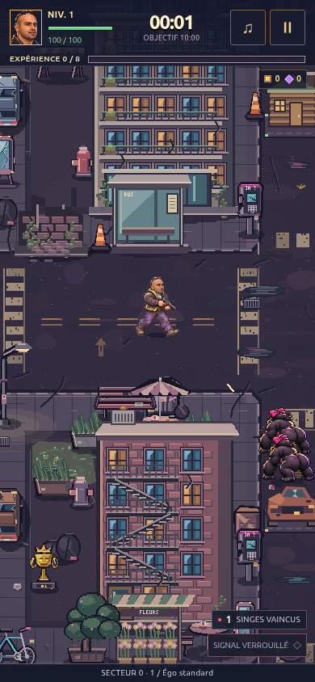

# Toma Popescu : 10 minutes sans IA

**[Jouer dans le navigateur](https://charlescstpierr.github.io/Popescu/)** · Gratuit. Pas de compte à créer.

> **Toma** : « Check le char. Huit cent mille piasses, mes abdos sont sortis, pis y'a même pas une criss de feuille dans ma piscine à Dubaï. »
>
> **Blonde IA** : « T'as demandé de retirer les feuilles de la photo. La piscine aussi est générée. »

<a href="https://charlescstpierr.github.io/Popescu/"></a>

Pis là, l'IA plante. Va falloir courir pour vrai.

Tu bouges, Toma tire tout seul. Ramasse l'expérience entre les gorilles et choisis ta prochaine carte : **Muscles Photoshop**, **Abonnés fictifs**, **Lamborghini imaginaire**. Même son char finit par servir à quelque chose.

Le bouc charge. Le coq gueule, pis Toma répond : *« Men, farmes ta criss de gueule ! »* Pis il fait le grand écart. Débloque la Blonde IA : elle tire des cœurs et répond à ses niaiseries.

Choisis ton niveau de déni : facile, normal, difficile ou cauchemar. Tiens dix minutes de survie jusqu'à l'arrivée de Charles. Après l'épilogue, tu peux continuer à l'infini.

**[Faire courir Toma](https://charlescstpierr.github.io/Popescu/)**

**Clavier** : WASD, ZQSD ou flèches. Échap pour la pause, M pour le son.<br>
**Tactile** : glisse le pouce en bas à gauche.

<details>
<summary>Jouer hors ligne ou ouvrir le code</summary>

Ta partie se sauvegarde dans ton navigateur. Le chrono attend pendant les choix et certains dialogues.

Sur ordinateur, [télécharge le ZIP](https://github.com/charlescstpierr/Popescu/archive/refs/heads/main.zip), extrais tout, puis ouvre `release/Toma_Popescu_JOUER.html`. Garde `release/assets/` à côté. Ne lance pas le HTML depuis l'aperçu du ZIP.

Les sauvegardes du site et du fichier local restent séparées. Les anciennes parties gardent leurs vingt minutes. Charles conserve un combat sans limite de temps après la survie.

JavaScript natif, sans compilation. Pour lancer les sources :

```bash
python3 -m http.server 8000 --directory dist
```

Ouvre `http://localhost:8000`. Les tests se lancent avec `npm test`, avec Node.js et Python 3.

[Instructions hors ligne](docs/EXPORTS-HORS-LIGNE.md) · [Contexte du projet](docs/REPRISE.md) · [Consignes de développement](AGENTS.md)

</details>

*Toma est un personnage parodique. C'est son ego qui mange les coups.*
