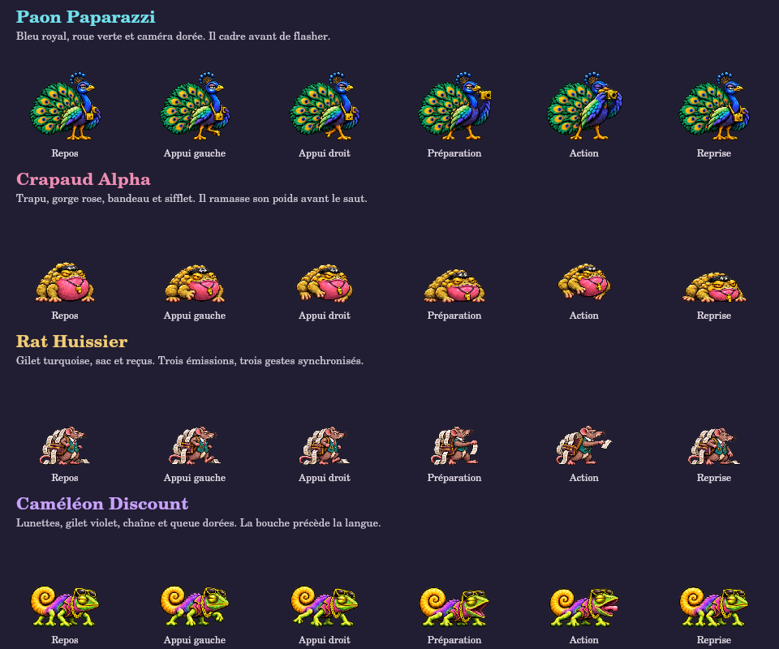

# Les quatre bêtes d’ego

Ce lot conserve les identités, les dimensions d’affichage et toutes les règles de combat existantes. Les dessins sont des corps entiers, avec miroir horizontal lorsque nécessaire.

## Paon Paparazzi

Bleu royal, roue verte, appareil photo doré. Il se donne en spectacle puis porte son appareil à l’œil. La préparation dure 1,2 seconde; le cadre fixé au sol devient dangereux pendant 0,2 seconde, puis il reprend sa pose pendant 1,25 seconde. Le centre du cadre reste sûr. Le flash est bref et désactivé en effets réduits; le cadre dangereux reste visible dans les deux modes.

## Crapaud Alpha

Corps ocre trapu, gorge rose, bandeau et sifflet. Deux appuis opposés remplacent le glissement d’une pose immobile. Il s’accroupit 1,05 seconde, saute vers un point annoncé, puis se réceptionne. La collision n’apparaît qu’à l’atterrissage. Sa pose écrasée reste visible pendant la récupération de 1,6 seconde, où il subit toujours les dégâts majorés déjà prévus par le jeu.

## Rat Huissier

Petit corps brun, gilet turquoise, sac couvert de reçus. Il prépare la liasse pendant 1,15 seconde. Le geste d’émission suit chacune des trois fenêtres dangereuses, séparées par les intervalles sûrs du moteur; il revient à la préparation dans ces intervalles. Il range ensuite sa liasse pendant 1,2 seconde. Aucun reçu peint n’ajoute de projectile ou de dommage.

## Caméléon Discount

Corps bas vert, lunettes, gilet violet, chaîne et queue dorées. Il ouvre la bouche pendant les 0,9 seconde d’avertissement. La langue part de sa bouche, y compris en miroir, sans déplacer le corridor de collision. Après 0,2 seconde d’action, il ferme la bouche pendant la récupération de 1,35 seconde. Son camouflage reprend selon les mêmes horloges et surfaces qu’avant.

## Retours communs

Les impacts ajoutent une teinte brève sur la silhouette entière. Le charme et la vie endommagée sont visibles comme pour les autres ennemis; ils suivent le crapaud en l’air. Aucun marqueur de vie ne trahit un caméléon camouflé. Les sauvegardes n’ajoutent aucun champ, et les horloges d’attaque restent celles de la simulation.

Six peintures ne constituent pas une animation à 60 dessins par seconde. Elles rendent les intentions et changements de phase plus lisibles; la fluidité et le tactile sur appareil réel restent à vérifier séparément des captures Canvas natives.
